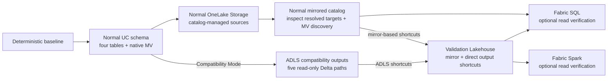

# Compatibility Mode demo

For a fresh independent deployment, use the [guided Python CLI](../deployment/README.md):
`python -m demos.deploy --demo compatibility --action configure`, then separately
approved preview/apply. Its executable SQL is generated from the shared model,
not by running the unresolved design template. It creates one OneLake-backed
normal schema with four catalog-commit tables and one native MV, enabling separate read-only ADLS
outputs, performs required initial loads/refreshes, and creates the normal mirror,
direct output shortcuts and an actually bound Fabric notebook. It pauses before
identity/location setup, seven-day/empty-output eligibility, freshness/provenance,
and real normal mirror discovery. Default checks do not run Fabric Spark or claim
end-to-end equality. Output generation/refresh and capacity can incur ongoing
charges; optional tests need separate consent. Keep private state for safe resume.
MV backing location, ID, version and protocol verification are excluded from
guided setup; unavailable backing metadata is not a blocker. Actual generated
output routing, IDs/protocol/features and shortcuts remain checked, but MV
backing-source freshness/provenance are not claimed as verified.
No second compatibility schema, compatibility Storage item or canary is provisioned.
The historical discovery/backing-protocol observations below are preserved, not
asserted to be universal limits or new deployer test results.

**Current design: single source.** Both access routes derive from the same
normal producer schema; only generated outputs use ADLS. The normal path
still uses a mirrored Azure Databricks catalog. Inspect its actual targets
after enablement: they may redirect to generated outputs. Neither a
compatibility-off negative control nor a particular Spark error is guaranteed.
See [`deployment-manifest.json`](deployment-manifest.json) for observed migration
status, immutable IDs and blockers, separately from historical results.

## Architecture

Edit [`architecture.mmd`](architecture.mmd); the diagram is embedded here:



The native MV is selected in the mirror definition. Create its mirror-based
shortcut only when actually discovered; record any discovery gap explicitly.

## Current MCAP migration observation

On 2026-11-15 the four normal managed table IDs and data were preserved.
Compatibility Mode now generates five new ADLS outputs from those tables and
the same native MV. The MV was replaced with compatibility properties at
creation, retaining its public UC ID. All five output logs report reader 1,
writer 7 and no `catalogManaged`; the four table clone IDs and source/refreshed
versions match (version 2). MV backing metadata was not inspected or verified.

After an explicit metadata refresh, the mirror exposes all five objects:
the four tables still resolve to their OneLake sources; the native MV resolves
to its new ADLS output. Five missing mirror-based Lakehouse shortcuts were
restored, and five known direct-output shortcuts repointed. The existing direct
MV shortcut keeps its name `compat_salesagg` and its connection. Both optional
validation notebooks were updated and their bindings verified, but not run.
No new Fabric SQL/Spark, append, data-equality or propagation result is claimed.

Canary schema/residual demo-MV entries and canary notebook were removed after
ownership/dependency checks. Compatibility Storage, canary mirror and old
pipelines were already absent. **Cleanup remains blocked** for the obsolete
compatibility schema: `DROP SCHEMA ... RESTRICT` reports one residual table
that table APIs and `information_schema` no longer identify. No force/cascade
was used on that uninspectable schema; its dependent obsolete OneLake external
location is retained pending administrator recovery. Old ADLS outputs and
shared infrastructure/identities/credentials/connections/roles are preserved.
The user-authorized resumed F8 capacity remains active and can incur charges.

## Historical validated deployment (before single-source migration)

On 2026-11-15, Fabric SQL queried all four normal mirrored tables and all five
compatibility shortcuts. Counts were 365 dates, 20 products, 100 customers,
10,000 sales lines and 9,452 aggregate groups. SQL's bidirectional comparisons
of normal and compatibility tables and its independent full-grain aggregate
comparison returned no differences; sales total was `930299.36`, quantity
`55196`, and line count `10000`. Both Databricks MVs refreshed successfully
and their complete rows matched via bidirectional `EXCEPT ALL`.

Fabric Spark `4.1.1.5.5.20260929.238183312` read all five compatibility
shortcuts; canonical sorted row hashes matched the independent deterministic
generator and aggregate reference. All four normal mirror-based Spark queries
failed with `Couldn't locate commit coordinator`. This is the observed
catalog-commit limitation, not a permission or timeout result. The normal MV
was not discoverable through its mirror, so its Fabric Spark result is
unavailable, not a demonstrated feature failure.

Normal table logs read through the mirror report reader 3/writer 7 with
`catalogManaged` in reader and writer features. All five generated output logs
read through their Lakehouse shortcuts report reader 1/writer 7, no reader
feature list and no `catalogManaged`; their clone source IDs match the respective
table or MV backing ID. The four table copies were current at source version 2,
and the MV output referenced backing version 2. The UC MV definitions report
`catalogManaged` supported, but direct backing-log inspection returned OneLake
403 and Databricks `LOCATION_OVERLAP`; the actual MV source protocol is
therefore unverified. On 2026-11-15, the documented
[`DESCRIBE DETAIL`](https://learn.microsoft.com/en-us/azure/databricks/tables/features/catalog-commits#check-if-catalog-commits-are-enabled)
check by UC name returned `EXPECT_TABLE_NOT_VIEW.NO_ALTERNATIVE` (SQLSTATE
`42809`) for each MV: it "expects a table but ... is a view." Consequently it
returned no `tableFeatures` for either MV. Both remain registered in UC as
`MATERIALIZED_VIEW`; the error does not disprove catalog commits. Exact
statements and IDs are recorded in the manifest. Reader/writer protocol numbers
are not runtime versions.

The workspace is `fabricinterop_compatibility`; use `fabricinterop_cc_normal_mirror`
for normal SQL and `fabricinterop_cc_validation` for compatibility SQL and
Spark. The [validation notebook](notebooks/validate_demo.py) uses the intended
shortcuts and collects per-table results without writing to sources. The
normal mirror's compatibility-off MV was selected but not surfaced. The
separate historical canary mirror maps its compatibility-enabled MV to its
generated output; that observation is not a normal-MV result.

## Local assets

[`config.example.json`](config.example.json) contains non-secret defaults and
blank IDs. [`prepare.py`](prepare.py) uses the shared generator to create a
local baseline and independent full-grain aggregate reference; it does not
deploy or contact cloud services. From the repository root:

```powershell
python demos\compatibility-mode\prepare.py --config demos\compatibility-mode\config.example.json --output-dir demos\compatibility-mode\prepared
python -m unittest discover -s demos\compatibility-mode -p "test_*.py" -v
```

The output directory must not already exist. It contains four CSVs,
`SalesAggregate.csv` and `reference.json`. They are local expected values,
not observed results. To validate a private config's ID-based proposed paths
without connecting, copy the example to `config.local.json`, verify and enter
the workspace and normal Storage IDs, an isolated ADLS output root and the catalog approval flag; run the same command with
`--check-paths` instead of `--output-dir`. This only validates syntax and
distinct path construction, not path existence, permissions or eligibility.
The helper models one managed source root and five distinct ADLS destinations.
It rejects legacy two-producer configurations; a syntax check is not migration approval.
For a future exported actual MV CSV with the same named columns, compare the
complete groups independently with
`python demos\compatibility-mode\compare_aggregate.py --reference demos\compatibility-mode\prepared\SalesAggregate.csv --actual <actual.csv>`.
It reports missing, extra and differing groups and rejects duplicate keys or
invalid fields; a match is only a comparison, not proof of mirror mapping.

[`sql/producer-template.sql`](sql/producer-template.sql) is a deliberately
non-executable template with unresolved placeholders for one managed producer
schema, informational keys, four compatibility table destinations, and one
native MV definitions. The constraint block follows independent key validation;
the compatibility definitions require separately verified, unused destinations.
It is not a deployment script and must not be executed over existing resources.
Offline tests compare the schemas to the shared generator and
evaluate the MV SELECT in SQLite against the complete baseline, using integer
cents for exact arithmetic. This does not validate Databricks SQL syntax,
feature support, creation, refresh, or cloud behavior.
[`sql/verify-aggregate-template.sql`](sql/verify-aggregate-template.sql)
sketches a bidirectional aggregate comparison and duplicate check; adapt and
validate its engine syntax for the engine being used.
[`evidence-template.md`](evidence-template.md) provides the per-object,
per-engine observation and exact-comparison checklist. The classifier in
`prepare.py` is a local helper, not a live check.

## Existing-demo migration and safe resume

Preserve the four normal source table IDs and data. Inventory actual workspace,
Storage, schemas, tables, volumes, mirror definitions, notebooks and shortcut
targets before any write; a capacity-related 404 is not resource absence.
Use five new, existing empty ADLS directories beneath the approved external
location, after checking privileges and seven-day ancestor/descendant history.
Never reuse or erase the old generated outputs. Managed tables can be altered;
the native MV needs compatibility properties at creation. Replace the known
demo-owned MV only when necessary and after dependency/ownership checks.

Refresh and inspect generated output metadata before repointing known
demo-owned direct shortcuts. Restore missing mirror-based shortcuts only from
actual discovery, not guessed paths. Stop on target collisions. Remove verified
obsolete demo schemas, compatibility Storage and canary items only afterward;
already-absent resources need no recreation. Keep shared credentials, identities,
connections, roles, accounts and catalogs. The deployer does not automate cleanup.

Keep the private state for resume: matching completed writes are not replayed.
Missing recorded shortcuts can be recreated only from their unchanged saved
target; changed targets or UC identities block. Legacy two-producer states stop
before cloud writes with migration guidance, rather than silently reloading or
overwriting. Setup verification is the default; SQL/Spark/append/propagation
checks require separate confirmation and compute-cost warning. MV backing
metadata verification is excluded.

## Historical feasibility investigation

The following investigation predates the user-authorized direct-shortcut
architecture and records the state at each attempt, not the current deployment.

On 2026-11-14, setting `delta.universalFormat.enabledFormats = compatibility`
and an isolated OneLake destination on the managed table failed with
`PERMISSION_DENIED`: `CREATE EXTERNAL TABLE` was required on the external
location. A grant scoped to the new location failed because the privilege was
reported inapplicable to `EXTERNAL_LOCATION_ONELAKE_MANAGED`. The location was
successfully used as managed storage, and its OneLake role grants the reused
managed identity read/write access. This is a privilege/type interaction
observed in this environment, not evidence that Fabric reads fail or that every
possible OneLake configuration is unsupported. Destination existence and
emptiness were not independently verified.

The exact sanitized pilot statement was:

```sql
ALTER TABLE dbxfabricinterop.fabricinterop_cc_compat.dimdate
SET TBLPROPERTIES (
  'delta.universalFormat.enabledFormats' = 'compatibility',
  'delta.universalFormat.compatibility.location' = 'abfss://200976aa-ae68-45b0-a575-1e16e8bfcc1f@onelake.dfs.fabric.microsoft.com/087dd564-3d1f-4341-99a7-c489185b9cab/Files/compatibility/dimdate'
)
```

Statement `01f1e072-6087-1975-b5ac-a97d548c74a7` returned:

```text
PERMISSION_DENIED: Principal 'System Administrator' does not have CREATE EXTERNAL TABLE on External Location 'fabricinterop_cc_compat'.
```

The attempted location-scoped grant returned:

```text
Privilege CREATE EXTERNAL TABLE is not applicable to this entity [fabricinterop_cc_compat:EXTERNAL_LOCATION/EXTERNAL_LOCATION_ONELAKE_MANAGED]. If this seems unexpected, please check the privilege version of the metastore in use [1.0].
```

Read-only checks on 2026-11-14 confirmed the target is lexically beneath the
registered location's `Files` root and is separate from the schema's `Files/managed`
root. This does not establish that the target exists, is empty, meets the
seven-day reuse rule, or will pass other checks. OneLake directory `HEAD`
requests made with the signed-in user's storage-scoped token returned HTTP 403
`Forbidden` for `Files`, `Files/managed`, `Files/compatibility`, and the target.
These responses cannot distinguish a missing path from an authorization failure;
they do not test the managed identity's access. No directory listing succeeded.

Paginated UC direct and effective-grant queries for both the location and
`fabricinterop_onelake_cred` returned empty objects; they did not report an
explicit grant. The credential is writable and workspace-isolated, and its
owner is also the location owner. Empty grant responses do not establish the
absence of owner or other implicit privileges. No credential grant was changed,
and whether a credential-level grant would satisfy the destination check remains
unknown. Owner identity came from the location and credential metadata, not
from the empty grant responses. The [ownership guidance](https://learn.microsoft.com/en-us/azure/databricks/data-governance/unity-catalog/access-control/permissions-concepts#ownership)
describes implicit owner capabilities; it does not establish that this
particular check succeeds. The [storage-credential guide](https://learn.microsoft.com/en-us/azure/databricks/connect/unity-catalog/cloud-storage/manage-storage-credentials)
recommends granting only `CREATE EXTERNAL LOCATION` on credentials. No
credential-level experiment was performed.

On 2026-11-14T22:12Z, `SELECT current_user()` confirmed that the SQL execution
identity matched the caller and the recorded owners of both the shared storage
credential and pilot location (statement
`01f1e078-7557-18c3-a717-40eeb8d79ef7`). Direct and effective credential-grant
queries still returned empty objects. The general ownership documentation
therefore indicates the caller already has the credential owner's implicit
capabilities, but it does not prove how this particular OneLake location check
is implemented. Compatibility Mode explicitly documents the privilege on the
**location**, not a credential-only override. Adding an explicit grant to the
same owner would be redundant under the documented model and, without an
identified safe empty destination, could not safely test whether the
Compatibility Mode check behaves differently. The shared credential was not
modified; an explicit-grant runtime workaround remains untested, not disproved.

The [Compatibility Mode documentation](https://learn.microsoft.com/en-us/azure/databricks/external-access/compatibility-mode)
requires `CREATE EXTERNAL TABLE` for its destination. Its generated output is a
separate, read-only down-level representation; it must not be confused with the
managed source. The [OneLake integration](https://learn.microsoft.com/en-us/azure/databricks/connect/unity-catalog/cloud-storage/external-locations-onelake)
documents the Fabric Spark limitation for catalog commits. The
[Fabric mirror tutorial](https://learn.microsoft.com/en-us/fabric/mirroring/azure-databricks-tutorial)
lists materialized views and streaming tables as selectable assets and recommends
`pipelines.externalMetadata.enabled = true` for their external access. However,
the [Databricks external-data-access limitations](https://learn.microsoft.com/en-us/azure/databricks/external-access/external-for-pipelines#limitations)
say that feature does not support Fabric and is incompatible with catalog
commits. This is a documentation conflict for this proposed combination, not
proof that all materialized views or all Fabric mirror configurations fail.

That external-data-access feature exposes the original dataset through catalog
APIs without a full copy; Compatibility Mode instead generates a separate
read-only, down-level representation. The feature was not substituted for
Compatibility Mode. Neither document establishes how a Fabric mirror selects
the generated compatibility path, and the conflict does not change the
feasibility gate. A vendor-supported clarification of both the MV access
requirements and mirror-to-output routing is needed before expansion.

### Can another OneLake external-location type help?

An **external location** is a UC-governed path and credential; it is not an
**external table**. The pilot already has a writable OneLake external location:
its ID-based Azure Databricks Storage path successfully hosts the managed table.
The location's UC API response reports `securable_type = EXTERNAL_LOCATION`,
`securable_kind = EXTERNAL_LOCATION_ONELAKE_MANAGED`, and `read_only = false`.
The original OneLake demo's location reports the same kind.

On 2026-11-14 we checked the [external-location create API](https://docs.databricks.com/api/uc-external-locations/v1/create-external-location.md),
its update API, the CLI help and the OneLake guide. None documents a choice of
`securable_kind` on creation or update, or the proposed
`EXTERNAL_LOCATION_ONELAKE_EXTERNAL` / `EXTERNAL_LOCATION_ONELAKE_NOT_MANAGED`
names. This does not prove that no private or future capability exists. No
supported way to select either kind was identified, so no speculative location
was created or modified.

The general [privilege reference](https://learn.microsoft.com/en-us/azure/databricks/data-governance/unity-catalog/access-control/privileges-reference)
also lists `CREATE EXTERNAL TABLE` on storage credentials, but Compatibility
Mode specifically requires the privilege on the destination external location.
Whether a credential-level grant would satisfy this particular check was not
established; the existing credential is shared and was not modified.
[OneLake federation](https://learn.microsoft.com/en-us/azure/databricks/query-federation/onelake)
is read-only and does not provide a writable compatibility destination. Direct
OneLake file writes are a separate integration, not evidence that Compatibility
Mode can use this location or that a mirror resolves its output.

### What about an external table with an explicit credential?

The [external-table reference](https://learn.microsoft.com/en-us/azure/databricks/sql/language-manual/sql-ref-external-tables)
does describe creating an external table with a storage credential instead of
an external location. The [CREATE TABLE reference](https://learn.microsoft.com/en-us/azure/databricks/sql/language-manual/sql-ref-syntax-ddl-create-table-using)
documents `LOCATION path WITH (CREDENTIAL credential_name)` for that operation.
It also prohibits overlapping managed-table locations. This is worth
distinguishing from the pilot: the producer is intentionally a **managed**
table, and Compatibility Mode requires a registered external location and
`CREATE EXTERNAL TABLE` on that location for its destination. Its documented
`ALTER TABLE` properties do not offer a credential override, and its producers
cannot be external tables. The reference does not establish whether explicit
credential external-table creation works for this OneLake managed-kind
location, nor whether it satisfies the separate Compatibility Mode check.

No OneLake external table or credential-level experiment was run. The user subsequently
approved necessary permissions and further tests, with OneLake first and a
storage-account fallback only as a last resort. A disposable-path experiment
still requires an identifiable, independently verified safe path and review of
supported OneLake paths and scoped privileges; even a successful external table
would not prove compatibility generation or mirror mapping. Do not register
the managed source files.

On 2026-11-14 a read-only prerequisite check for an isolated external-table
pilot could not verify an empty OneLake path. The current caller matched the
credential and pilot-location owners in metadata; the credential was writable.
Schema effective grants included inherited `ALL_PRIVILEGES`. A `LIST` of the
pilot item root without a credential failed with `PERMISSION_DENIED` for
`READ FILES` on the pilot location (statement
`01f1e077-10f5-10a3-a8f1-e42bfb056ca0`). A `LIST` with the explicit credential
failed with `INVALID_PARAMETER_VALUE.PATH_BASED_ACCESS_NOT_SUPPORTED_FOR_FABRIC`
(statement `01f1e077-3f71-146e-a4cd-47b3ef3f56d1`). Neither error establishes
whether external-table creation would succeed. No external table was created.

After the user's broader permission approval, a narrowly scoped attempt to
grant `READ FILES` on the demo-owned external location failed as inapplicable to
`EXTERNAL_LOCATION_ONELAKE_MANAGED` (statement
`01f1e077-6f37-1941-b8bc-0189541cdb43`); no such grant was applied. No shared
permissions or credential settings were changed.

### Requested fallback inventory

The user approved a last-resort separate container in the account holding
Databricks managed data, with a folder spelled `compatiblity` and a schema
subfolder. Read-only Unity Catalog metadata identifies that account as
`dbstorager5gnpvsw2lsxs`; its existing managed data is in
`unity-catalog-storage`. It belongs to the Databricks workspace's managed
resource group `rg_fabricdbxinterop_managed`. ARM returned a system-protected
deny assignment at this resource group covering all principals, all data
actions and control-plane actions except specified exemptions, applying to
child scopes. Container writes are not among those exemptions; the signed-in
user and reused managed identity are not the excluded service principal.
See [Azure deny assignments](https://learn.microsoft.com/en-us/azure/role-based-access-control/deny-assignments).
No new container was attempted or created there; this is a protected-resource
blocker, not an observed container-creation error. Do not bypass or alter the
deny assignment. The user subsequently specified the separate existing account
`dbxfabricinterop` for compatibility output only; it is not the selected
catalog's default managed-storage account.

The user also said a path was empty, but the exact path was not identified.
That statement cannot establish which destination was checked or whether the
seven-day Compatibility Mode restriction is satisfied. OneLake remains
unproven; do not represent the two LIST errors as a failed external-table test.

### ADLS output and mirror pilot

After the OneLake investigation, the user-approved output-only fallback was
tested in a new private container `fabricinterop-compat-200976aa` in
`dbxfabricinterop`. The new container was listed empty, then the new
`compatiblity/fabricinterop_cc_compat/dimdate-200976aa` directory was created
and listed empty. This fresh container establishes no prior Compatibility Mode
use of the destination or parents. The manifest records its UC external
location, a container-scoped Blob Data Contributor role and an account-scoped
Blob Delegator role for the reused managed identity. A temporary
container-scoped caller role was removed and its absence verified. The account,
credential and identity are reused, not cleanup targets.

On 2026-11-14, `ALTER TABLE` succeeded (statement
`01f1e07a-7ed0-1be2-96ef-ae35842b7745`); manual refresh succeeded (statement
`01f1e07a-a8b7-1735-a57a-e2979529d9a8`). The empty managed source remained
on OneLake with reader 3/writer 7 and `catalogManaged`. The generated ADLS
Delta log recorded reader 1/writer 7, no `readerFeatures`, and writer features
`domainMetadata`, `redirectWriterOnly-preview`, `rowTracking`, `invariants`,
`appendOnly`, `inCommitTimestamp`, and `clustering`. The output is read-only;
neither protocol number is a Databricks Runtime version.

The partial pilot mirror `fabricinterop_cc_compat_mirror`
(`7f0b14b6-52e7-45d4-af1d-d292f91e2740`) synced `dimdate` successfully but
its DatabricksCatalog shortcut identifies the original OneLake managed path.
Reading version 0 of the Delta log **through that mirror** returned reader
3/writer 7 with `catalogManaged` in reader features, not the ADLS output
protocol. Fabric SQL independently listed the table and `COUNT_BIG(*)`
returned 0, consistent with the empty source. This does not demonstrate a
compatible-output read. At that point native MVs and the full comparison had
not yet been tested. The observed mapping failed the original gate; it does not prove that every possible product
configuration is unsupported.

On 2026-11-15 a read-only reconciliation found one mirrored Databricks catalog
in the demo workspace. Its partial definition selects only
`fabricinterop_cc_compat.dimdate`, and its shortcut still resolves that
compatibility-enabled table's OneLake managed source, not its separate ADLS
compatibility output. At that time the compatibility-off normal schema did not exist, and
the isolated canary read schema has no registered tables after the failed
`LOCATION_OVERLAP` experiment. Thus neither requested mirror is yet present in
its intended role at that time: a supported mapping from the generated output to a
selectable UC asset or mirror configuration remains unresolved. A second mirror
was not created because it would not establish the requested distinction.

On 2026-11-14 a signed-in MCAP user connected to the mirror's SQL
endpoint with an Azure SQL token, listed `fabricinterop_cc_compat.dimdate`,
and queried `COUNT_BIG(*) = 0`. The demo-owned
`fabricinterop_cc_validation` Lakehouse contains a OneLake shortcut to the
**mirror item**, not to the storage item. Its REST table list reported
`pilot_dimdate` as Delta. The bound
`fabricinterop_cc_validate_source` notebook then independently attempted
Spark catalog listing and a count through that shortcut. Both failed with
`java.lang.IllegalStateException: Couldn't locate commit coordinator for:
spark_catalog.fabricinterop_cc_validation.pilot_dimdate`. The job completed
with explicit failed operation results in its exit value; this was a
commit-coordination failure, not a permissions or readiness timeout. Its Spark
version was `4.1.1.5.5.20260929.238183312` and Python version `3.13.11`;
run ID and UTC timings are in the manifest. The producer had Compatibility
Mode enabled, but the mirror exposed its catalog-managed **source**. This is
neither a test of the generated output nor the requested compatibility-off
normal control.

The generated Delta metadata describes a `ReadClone` linked to the source ID
and includes a `redirectWriterOnly-preview` configuration with refresh and
vacuum exceptions. The generated ADLS path and managed OneLake source are
physically separate. [CREATE TABLE](https://learn.microsoft.com/en-us/azure/databricks/sql/language-manual/sql-ref-syntax-ddl-create-table-using)
documents inheriting existing Delta configuration but does not establish that
registering this live read clone is write-free or safe for subsequent refresh.
[Compatibility Mode](https://learn.microsoft.com/en-us/azure/databricks/external-access/compatibility-mode)
says its output is read-only. The restriction on external tables as Compatibility Mode *producers* does not
itself answer whether the separate generated output may be registered.

With explicit authorization, a separate, demo-owned canary source and output
were created, without touching the existing pilot table or its output. The
canary source used its own OneLake managed root; the generated ADLS path was
new and disjoint. A temporary external volume was used only to create its
empty directory, then its metadata was dropped while preserving the directory.
The source contained one row and its generated copy was current at source
version 2. A separate canary schema was created for the proposed registration.

The experimental `CREATE TABLE ... USING DELTA LOCATION` on **the generated
canary output**, not the managed source files, failed
`INVALID_PARAMETER_VALUE.LOCATION_OVERLAP` (statement
`01f1e07c-d9d9-105d-90cc-1c5df4744d2f`); UC identified the canary source as
the conflicting table. No external table was created. Immediately afterwards,
source history and rows were unchanged and all listed output objects retained
their ETags and lengths. A subsequent canary-only append and manual refresh
succeeded: source and last refreshed source version were 3, and generated Delta
version 1 appeared. The absent registration could not be mirrored or queried
through Fabric SQL or Spark. This is a bounded experimental result, not a
vendor-supported workaround or proof that all alternative configurations fail.
See the manifest for exact resource and statement IDs.

The [Compatibility Mode documentation](https://learn.microsoft.com/en-us/azure/databricks/external-access/compatibility-mode#reading-compatibility-versions-from-the-unity-rest-api)
also describes external clients reading compatibility versions by name through
the Unity REST API, with special parameters for streaming tables and materialized
views. The [Fabric mirror tutorial](https://learn.microsoft.com/en-us/fabric/mirroring/azure-databricks-tutorial)
documents selecting catalog assets but does not document a control for choosing
the generated compatibility path or those API parameters. The API route is
therefore not evidence that the existing mirror can resolve this output; a
direct external-client read would not satisfy the mirror gate. No further
mirror configuration is claimed supported or tested on this basis.

This historical mirror gate was superseded by the user's authorization to use
direct shortcuts for compatibility outputs only. The table pilot mirror still
resolves its original source. A later canary mirror resolved a compatibility
MV to its generated output, but this did not establish the same mapping for
managed tables.

## Operating the demo

1. Reconcile immutable IDs in the manifest and confirm the MCAP tenant. Do not
   recreate or overwrite existing resources or load the baseline again.
2. Query the normal mirror's SQL endpoint under `fabricinterop_cc_normal`; the
   four normal table shortcuts in the validation Lakehouse target this mirror.
   The selected normal MV is not currently exposed.
3. Query `dbo.compat_dimdate`, `dbo.compat_dimproduct`,
   `dbo.compat_dimcustomer`, `dbo.compat_factsales`, and
   `dbo.compat_sales_by_day_product_region_segment` in the Lakehouse SQL
   endpoint, or their fully qualified Lakehouse names in Spark. These are
   read-only shortcuts to generated ADLS paths.
4. For current results, verify source versus output versions before comparing
   data. Refresh a compatibility copy with `REFRESH TABLE <catalog.schema.table>
   SYNC UNIFORM`; use `REFRESH MATERIALIZED VIEW` for the native MV and
   `REFRESH MATERIALIZED VIEW <catalog.schema.mv> SYNC UNIFORM` when an
   explicit copy refresh is needed. Refreshes can incur compute charges.
   Use the 900-second deadline and report permission/readiness failures
   separately from feature-related failures.

The local SQL templates are design references, not an idempotent deployer.
Rerun safety has not been demonstrated. Do not register managed files,
replace generated copies with CTAS tables, or remove catalog commits.

## Running costs

The existing F8 Fabric capacity remains active and can incur its usual capacity
charges. The reused `fabricinterop-powerbi-demo` serverless SQL warehouse was
running at 2026-11-14T21:33:08Z with a 10-minute auto-stop setting; it may incur
compute charges while running. Both producer sets and generated outputs incur
storage charges. Compatibility Mode automatic refreshes can incur background
charges. No new persistent cluster or custom scheduled refresh
job was created. Shared compute and capacity were not stopped or resized.

## Cleanup and dependencies

Nothing is deleted automatically. Any cleanup must be separately confirmed,
limited to exact demo-owned resources in the manifest, and ordered after
checking dependencies. The parent catalog, Databricks workspace, capacity,
warehouse, connection, credential, and managed identity are reused resources,
not demo 3 deletion targets. The pilot uses demo 1's credential and connection;
do not remove either until those dependencies are explicitly resolved. The
manifest identifies demo-created role assignments for the Databricks managed
identity and workspace identity; assess their dependencies and remove only
demo-created assignments as part of separately confirmed cleanup.
