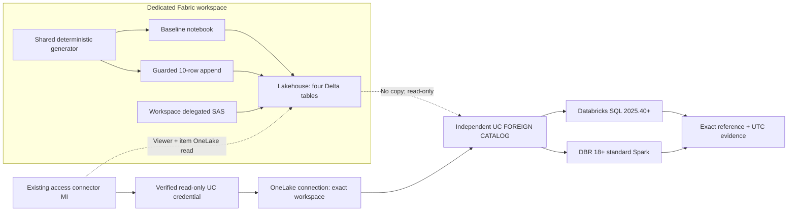

# Demo 4: OneLake catalog federation

Fabric owns the four sales-star-schema Delta tables in a dedicated, schema-enabled
Lakehouse. Databricks queries them directly through **OneLake catalog federation**:
no copying, UC managed table, external location, mirror, shortcut, Power BI
publication or Compatibility Mode is involved. Access is read-only.

The foreign catalog is an independent Unity Catalog top-level object. It is
**not** a schema inside the existing `dbxfabricinterop` catalog. Reuse the existing
Databricks workspace/metastore, capacity and a verified suitable identity/credential;
connections are specific to a Fabric workspace. Never reuse a differently scoped
connection or change a shared writable credential to read-only.

## Architecture

Editable source: [architecture.mmd](architecture.mmd).



## Prerequisites and manual gates

Follow [Microsoft's OneLake federation guide](https://learn.microsoft.com/en-us/azure/databricks/query-federation/onelake).
Unity Catalog must be enabled. SQL requires warehouse version **2025.40+**;
Spark requires **DBR 18.0+ and standard access mode**. Verify outbound OneLake
connectivity and colocate compute/capacity where possible to reduce transfer cost.
DBR 19+ uses workspace-specific OneLake endpoints: allow those in custom DNS/firewalls.

An administrator must verify the tenant settings **Service principals can call
Fabric public APIs**, **Allow apps running outside of Fabric to access data via
OneLake**, and **Use short-lived user-delegated SAS tokens**. In the dedicated
workspace enable **Authenticate with OneLake user-delegated SAS tokens** under
Workspace settings > Delegated settings > OneLake settings. The deployer never
changes tenant settings or assumes an unreadable setting is enabled.

Verify the selected access connector's immutable principal and tenant IDs.
Grant it workspace **Viewer**, then Lakehouse **Read all OneLake data / Read all
with Apache Spark**. SQL-only read permission is insufficient. The documented
workspace-wide alternative is Contributor, but is broader and needs separate
approval; do not silently escalate. For restricted inbound networking follow
the guide's same-tenant resource-instance rule or cross-tenant private-endpoint
instructions. Approve only the selected connector/workspace.

The deploying principal needs approved metastore CREATE CONNECTION,
CREATE STORAGE CREDENTIAL and CREATE CATALOG privileges, and connection ownership
or CREATE FOREIGN CATALOG. Reader grants should be limited to USE CATALOG,
USE SCHEMA and SELECT on the new foreign catalog/schema.

## Guided setup

```text
python -m demos.deploy --demo federation --directory .demo-deploy/federation --action configure
python -m demos.deploy --directory .demo-deploy/federation --action preview
python -m demos.deploy --directory .demo-deploy/federation --action apply
python -m demos.deploy --directory .demo-deploy/federation --action resume
```

See [example configuration](config.example.json); it contains no credentials.
Replace placeholder IDs and use a private directory. Configure Azure CLI tenant
isolation and the exact Databricks profile separately. All-demos mode includes
federation with its own workspace and independent foreign catalog.

Preview and explicit confirmation precede writes. Initial Fabric baseline loading
and UC SQL DDL use chargeable compute. The baseline notebook embeds the **same**
shared generator and schema rather than a second implementation. Default sizes
are 365 dates, 20 products, 100 customers, 10,000 sales, seed 42, Decimal money.
The ipynb definition carries actual `metadata.trident.lakehouse` binding.
Source writes use fully qualified workspace/lakehouse/dbo/table names, refuse
foreign ownership or changed baselines, and never overwrite.

Setup creates two notebooks but runs **only baseline**. Resource identities,
definitions and completed statements/jobs are setup evidence, **not an E2E pass**.
Private state records write intents and operation IDs before polling, rejects
changed configuration/ownership and does not blindly replay uncertain writes.
An existing connection is reread and must match its immutable ID, OneLake type,
workspace and credential. An existing catalog name is never adopted.

## Demonstration and evidence

The supported DDL is illustrated in [queries.sql](queries.sql). Discover actual
schemas/table names using SHOW SCHEMAS/SHOW TABLES; do not guess `dbo` on the
Databricks side. Use [Spark reader](spark-reader.py) with the embedded shared
generator and discovered names.

`--optional-checks` separately confirms scans and Spark evidence. SQL baseline
comparison checks every value in all four tables against the independent
generator. Spark/append manual checkpoints are attestations, never manufactured
passes. The 10-row Fabric append requires another affirmative confirmation.
Only the new sales key range is appended; repeated execution detects the exact
already-appended batch and makes no second mutation.

For a live run, record the producer exit value's actual Delta commit timestamp
and version, job IDs, SQL statement IDs, runtime/access mode, baseline row equality,
append row equality and observed UTC timestamps. Fix one deadline from the
**source commit** (for example 10 minutes), never from the first successful read
or a rerun. Compare baseline plus `generate_sales_batch(sample, sample.sales_rows
+ 1, 10)` in **both SQL and Spark**. Source completion alone is not visibility.
Keep a late observation as late, and record feature/permission/network failures
as blocked rather than substituting direct ABFSS reads or copied tables.

See [deployment evidence](deployment-manifest.json) for actual live status;
portable setup examples do not certify a particular tenant.

## Cleanup boundary

There is **no automatic cleanup**. With separate explicit approval, remove only
this deployment's foreign catalog, demo-owned connection, notebooks, Lakehouse
and dedicated workspace after checking immutable IDs, ownership and dependencies.
Preserve reused credentials, access connector, capacity, Databricks workspace,
metastore and all other demos. Do not suspend a shared capacity or erase source
data without approval. Compute/capacity may continue charging after the process exits.
